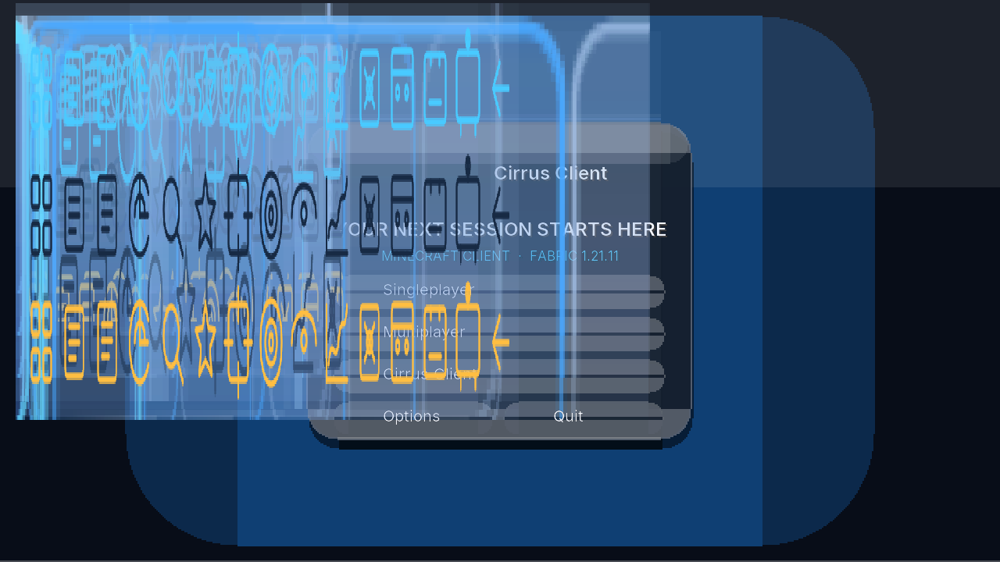
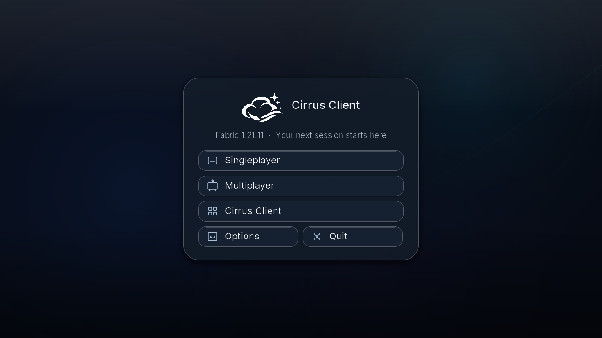
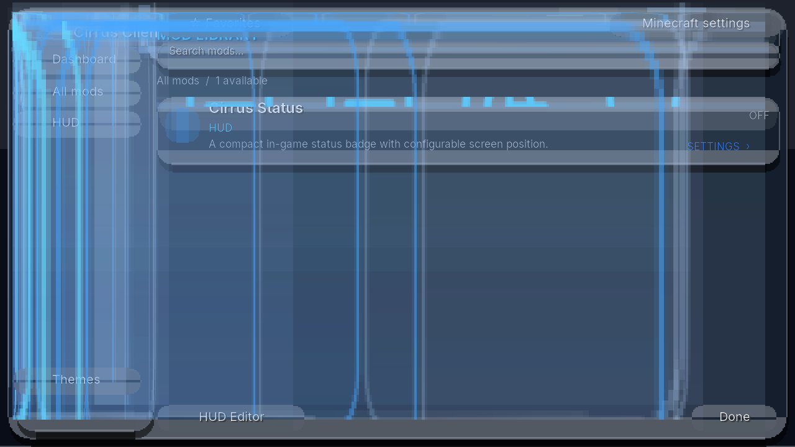
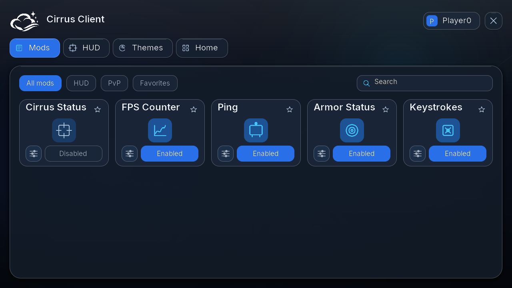

# Fabric UI: before and after

Real screenshots from the Minecraft 1.21.11 client, taken by the `Fabric in-game check` workflow (Fabric client gametest under Xvfb, software OpenGL). Before = the Stage 2 UI as merged; after = this branch.

| | Before | After |
|---|---|---|
| Title |  |  |
| Mod menu |  |  |

More after shots: [HUD editor](after/hud-editor.png), [light theme](after/menu-light.png), [small window, GUI scale 3](after/menu-small-gui3.png).
