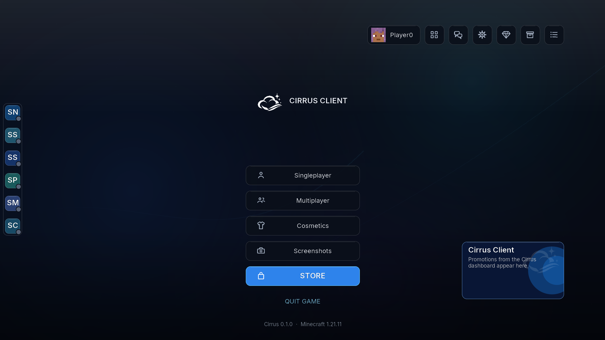
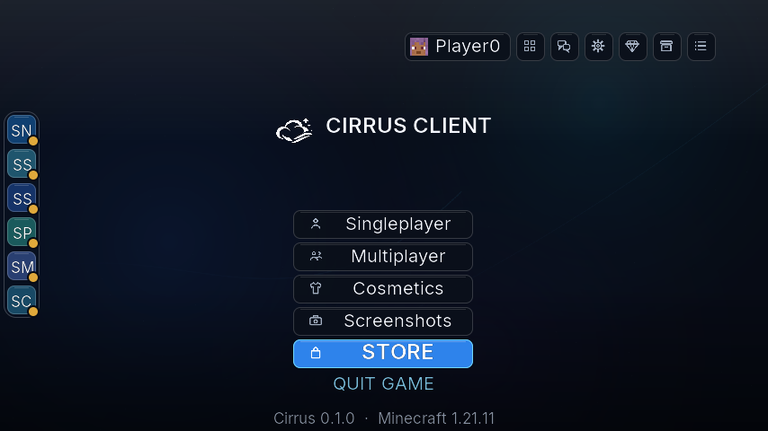
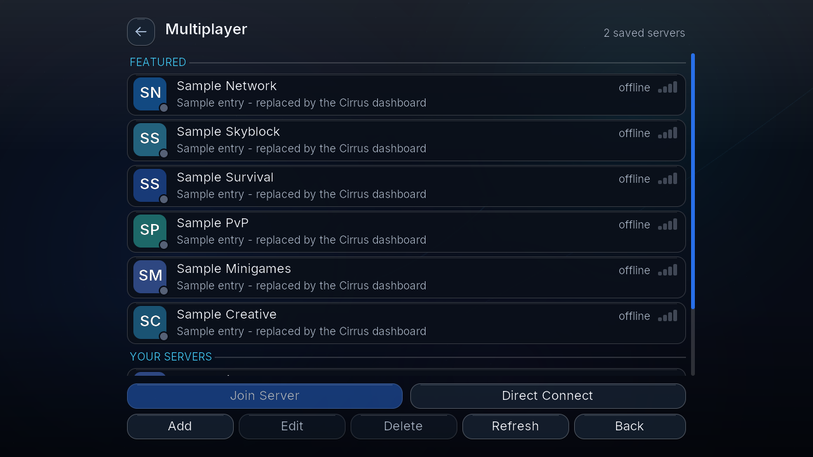
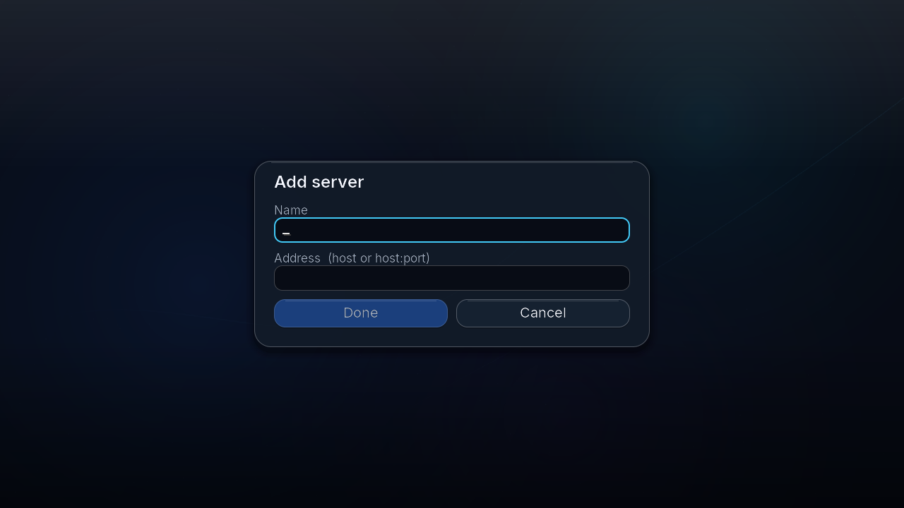

# Fabric UI: before and after

Real screenshots from the Minecraft 1.21.11 client, taken by the `Fabric in-game check` workflow (Fabric client gametest under Xvfb, software OpenGL). Before = the Stage 2 UI as merged; after = this branch.

| | Before | After |
|---|---|---|
| Title |  |  |
| Mod menu |  |  |

More after shots: [HUD editor](after/hud-editor.png), [light theme](after/menu-light.png), [small window, GUI scale 3](after/menu-small-gui3.png).

## Feather-layout main menu and Multiplayer (real in-game screenshots)

Captured by the Fabric client gametest on Minecraft 1.21.11 (Mesa software GL in CI), not generated previews.
The partner entries are bundled *samples* shown as offline because CI has no network; see [DASHBOARD.md](DASHBOARD.md).

| Main menu, 1920x1080 GUI 2 | Main menu, 854x480 GUI 3 |
|---|---|
|  |  |

| Multiplayer, 1280x720 GUI 2 | Add server form |
|---|---|
|  |  |
