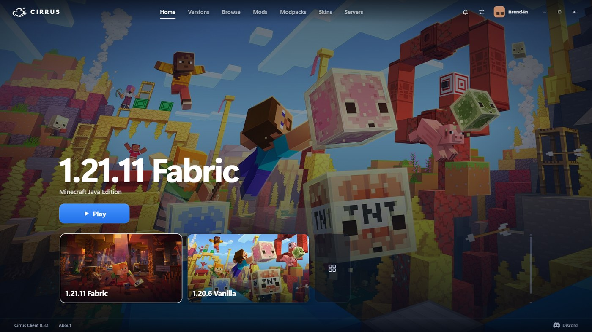
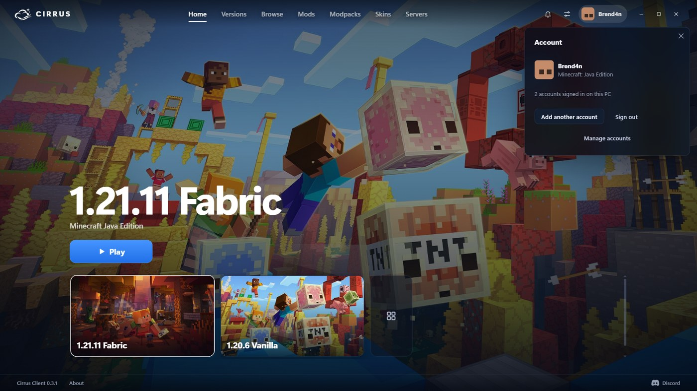
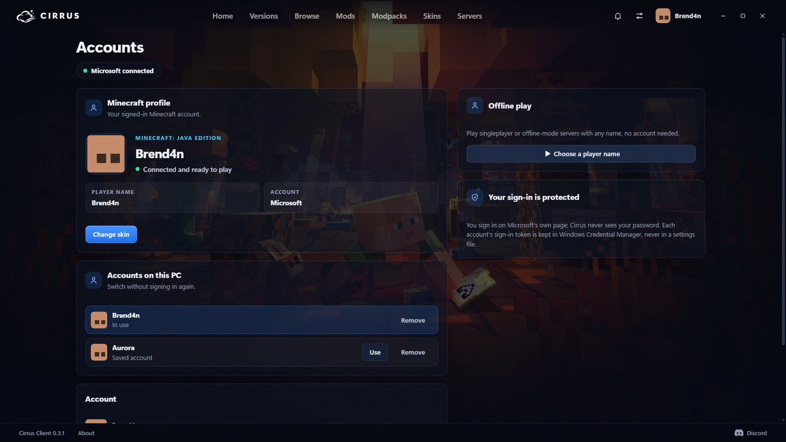
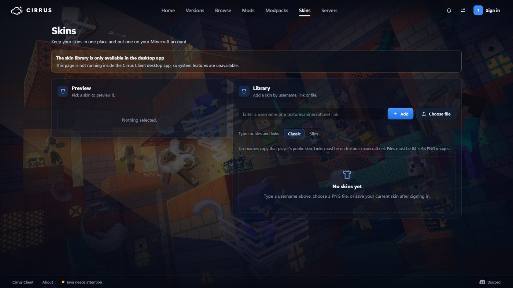
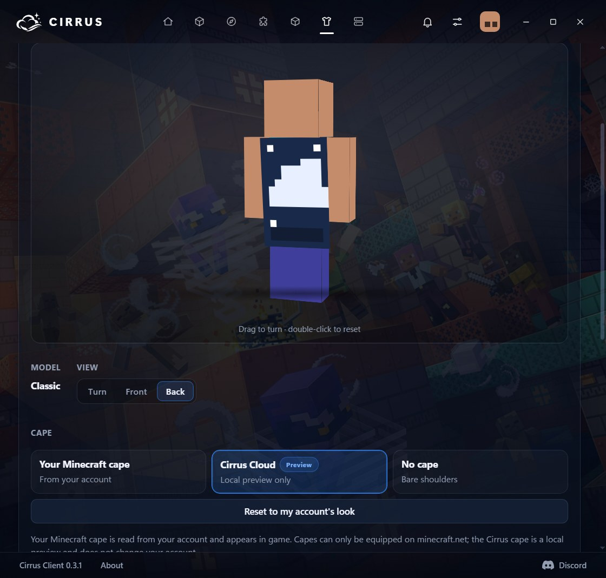
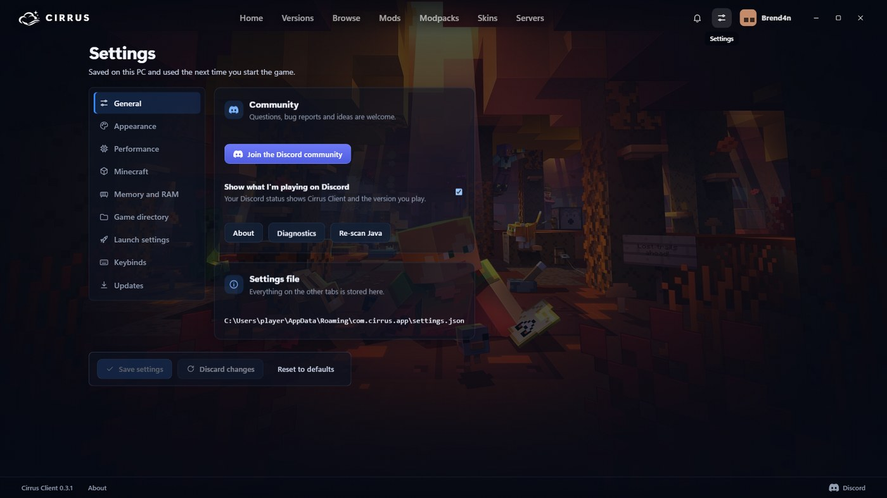
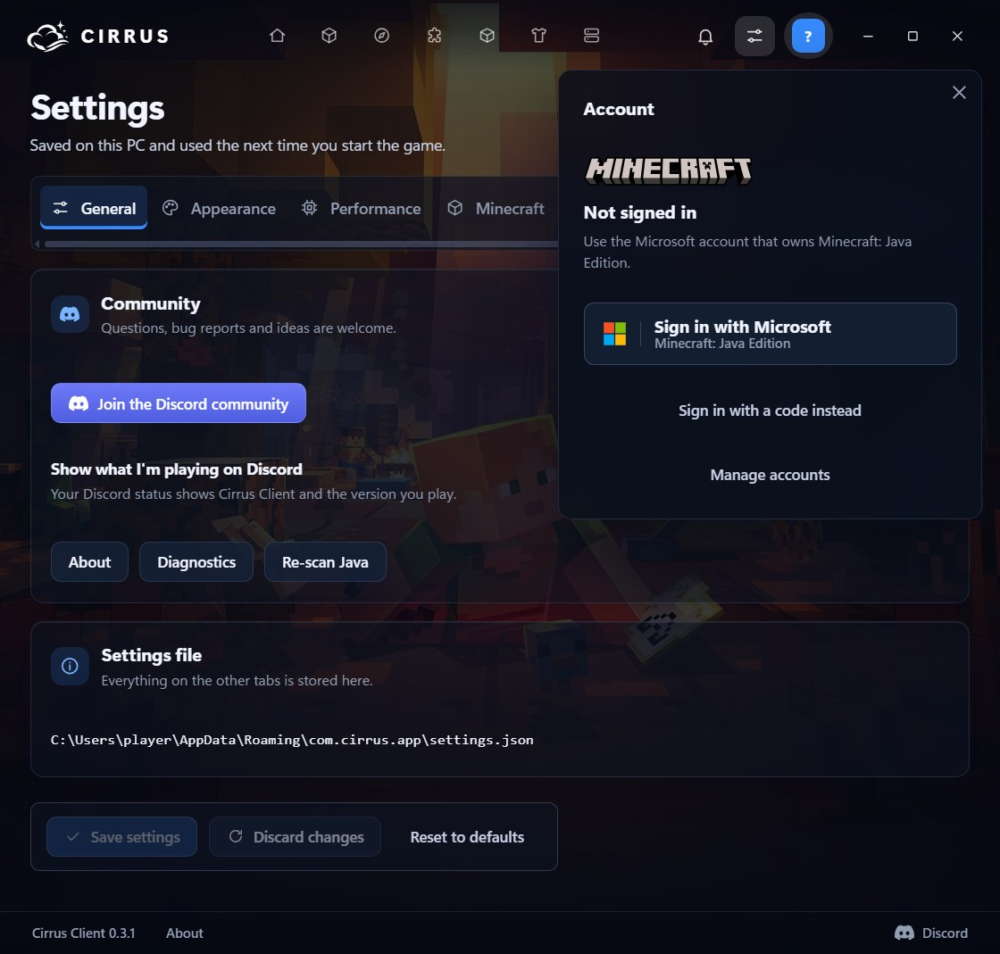

# Cirrus Client 0.3.1 — review screenshots

Captured from a production build of the web frontend with the mocked desktop
commands from [`scripts/visual-check.mjs`](../../../scripts/visual-check.mjs):
the layout, branding, copy and account flow are real, while the Microsoft and
Mojang service responses are fixed fixtures. They are here so the pull request
can be reviewed without a Windows machine; the CI "Visual check" workflow
regenerates and publishes its own screenshot set on every push to this branch.

## Home

## Account menu

## Accounts page

## Skins page

## Skins page — cape preview from behind

## Settings

## Signed-out account panel

